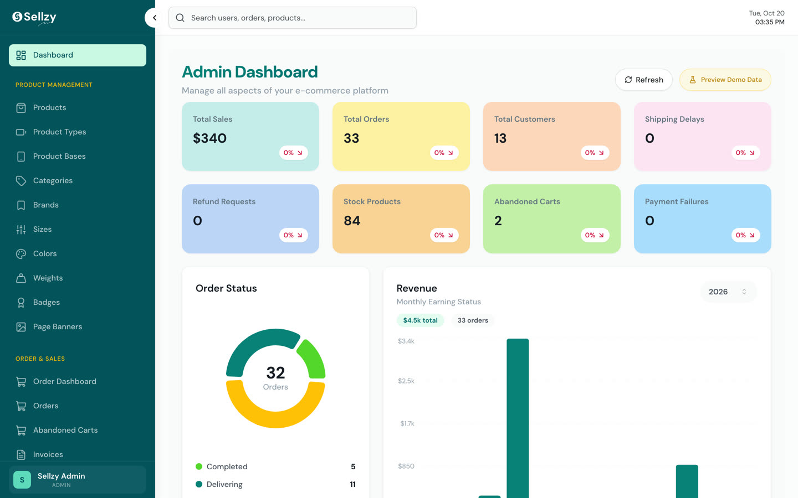

# Sellzy Starter

<p align="center">
  
  
</p>

The starting point for **Sellzy from Scratch**, the ReactBD course where you build a complete multi-vendor e-commerce
platform: a **Next.js** storefront with three home pages, 24 shop layouts, search, cart, checkout and Stripe; a
**React + Vite** dashboard for the admin, the team and the sellers; and an **Express + MongoDB** API behind both. It's one
Turborepo monorepo, in TypeScript from end to end.

This repo is the project exactly as it stands after the course's first two parts, *An empty folder* and *The ground
rules*. Each app shows a single heading, the shared TypeScript and ESLint setup is in place, and every asset the course
uses but never types is already in its folder. There are no features yet. Building them is what the course is for.

**The pictures above are where you'll end up, not what this starter shows.**

## Links

| | |
|---|---|
| The course | **Sellzy from Scratch** on [ReactBD's YouTube channel](https://www.youtube.com/@reactjsbd), in two volumes: the API and the storefront, then the dashboard, sellers and going live |
| Live storefront | [sellzy.reactbd.com](https://sellzy.reactbd.com) |
| Live dashboard | [admin.sellzy.reactbd.com](https://admin.sellzy.reactbd.com/login): the **Master Admin** and **Seller Panel** buttons fill in demo credentials |
| ReactBD | [reactbd.com](https://reactbd.com) |

## Where this fits in the course

| Part | Starts at | What happens |
|---|---|---|
| 1. An empty folder | 0:12:44 | builds this repo: the workspace, the three apps, the first page of each |
| 2. The ground rules | 0:24:27 | shared TypeScript configs, linting, the `@/` alias, the env files Git ignores |
| **3. From Figma to tokens** | **0:32:05** | **start here** if you cloned this starter |

The times are in Volume 1. Watching from the beginning? Parts 1 and 2 build all of this step by step. Follow along from
an empty folder and keep this repo open to compare, or to copy the asset pack (below) from.

## What you need

- **Node 22.22 or newer.** Check with `node -v`. The apps declare Node 24 for deployment, so Node 24 LTS is the best
  match; on Node 22 pnpm only warns.
- **pnpm 10.29.3**, through Corepack: run `corepack enable` once. The repo's `packageManager` field picks the
  version. Without Corepack, `npm install -g pnpm@10.29.3` works too.
- **Git**
- **VS Code** with the **ESLint** and **Tailwind CSS IntelliSense** extensions.

Free accounts come later, each with the part that needs it, so there's nothing to set up yet:

| Service | For | Part |
|---|---|---|
| MongoDB Atlas (free cluster), or MongoDB on your machine | the database | 6 |
| Firebase and a Gmail app password | Google sign-in and email | 8 |
| ImageKit (required); Cloudinary and Amazon S3 (optional) | product photos | 11 |
| Stripe in test mode; SSLCommerz sandbox (optional) | payments | 19 |

## Quick start

```bash
git clone https://github.com/noorjsdivs/sellzy-starter.git
cd sellzy-starter
corepack enable
pnpm install
pnpm dev
```

One `pnpm install` at the root installs every workspace, and `pnpm dev` starts all three apps:

| App | Address | You should see |
|---|---|---|
| Storefront | http://localhost:3000 | **Sellzy storefront** |
| Dashboard | http://localhost:5173 | **Sellzy dashboard** |
| API | http://localhost:8000 | `{"message":"Sellzy API is running..."}` |

## Scripts

Run these from the repo root:

| Command | What it does |
|---|---|
| `pnpm dev` | starts the storefront, the dashboard and the API together |
| `pnpm dev:web` · `pnpm dev:admin` · `pnpm dev:api` | starts one app |
| `pnpm check-types` | type-checks every app |
| `pnpm lint` | lints every app with the shared ESLint configs |
| `pnpm build` | builds every app |
| `pnpm format` | formats `.ts`, `.tsx` and `.md` files with Prettier |
| `pnpm seed` | loads the demo data into MongoDB (the seed script arrives in part 10) |
| `pnpm clean` | removes build output and caches |

`pnpm check-types` and `pnpm lint` both pass on a fresh clone, three tasks each. Keep it that way as you build: run them
before every commit.

## What's inside

```text
sellzy-starter/
├── package.json             the repo's scripts; Turborepo, Prettier, TypeScript 6
├── pnpm-workspace.yaml      the workspaces: apps/* and packages/*
├── turbo.json               build, dev, lint, check-types and seed, across every app
├── .gitignore               also ignores every .env file
├── packages/
│   ├── typescript-config/   shared tsconfig bases: base, nextjs, react-library
│   └── eslint-config/       shared ESLint configs: base, next, react-internal
├── apps/
│   ├── web/                 the storefront: Next.js App Router, one heading for now
│   ├── admin/               the dashboard: React and Vite, one heading for now
│   └── api/                 the API: Express, where GET / answers a JSON message
└── docs/                    the two pictures above
```

### The stack

| | Version |
|---|---|
| Next.js | 16.4, with the React Compiler |
| React | 19.3 |
| Tailwind CSS | 4.3 |
| Vite | 8.3 |
| Express | 5.3 |
| TypeScript | 6.0, strict |
| Turborepo | 2.11 |
| pnpm | 10.29.3 |

Stay on these versions while you follow the course: the code in the video is written for them.

## The asset pack

The video points you here for everything that can't be typed: images, icon drawings, translations and the demo data.
It's already unpacked, each file at the path the course uses, so if you cloned this starter you don't copy anything.

Following along from an empty folder? Copy these files and folders from this repo into the same places in your
project. Copy them all at the start, or each one when its part reaches it.

| Path | What it is | Used from |
|---|---|---|
| `apps/api/data/seed/` | the demo data: 40 JSON files, 278 records, including 83 products in 34 categories, brands, banners, menus, blog posts, jobs and sample orders | part 10, where `pnpm seed` loads it |
| `apps/web/messages/de.json`, `fr.json`, `it.json`, `en-SG.json` | the translations (`en.json` is typed in the part) | part 22 |
| `apps/web/public/` | logos, illustrations, placeholders and payment badges | part 23 on |
| `apps/web/src/images/` | the storefront's own images and icons (the part types the `index.ts` that imports them) | part 23 |
| `apps/web/src/components/svgs/` | `BrandIcons.tsx`, `HeaderFlags.tsx` and `index.tsx`: the icon drawings | part 24 |
| `apps/web/src/components/order-tracking/dummyOrderData.ts` | the order-tracking page's demo order | part 33 |
| `apps/admin/public/` | the dashboard's logos and placeholder image | part 36 on |
| `apps/admin/src/components/ui/brand-icons.tsx` | the brand icons for the dashboard | part 37 |
| `apps/admin/src/lib/preview/vendorPreviewData.ts` | the sample data the seller portal shows preview users | part 67 |

A few things to know about the data:

- **Product photos are links** inside the seed, so the storefront needs an internet connection to show them.
- **The people in it are made up:** Maya Chen, Jordan Lee and Aisha Bello, with `example.com` addresses and 555
  numbers.
- **No accounts are seeded.** You register your own, and part 38 shows how the first admin is made.

## Make it yours

- **Keep secrets out of Git.** Later parts add `apps/api/.env`, `apps/web/.env` and `apps/admin/.env`. The course shows
  their key names, never their values, and `.gitignore` already ignores them. Check `git status` before you push
  anyway.
- **Generating the apps yourself in part 1?** Today's generators differ a little from the video:
  - `create-next-app` 16.4.2 now writes Tailwind's Turbopack loader and Cache Components into `next.config.ts`, in place
    of a PostCSS config. The course uses the PostCSS setup, so take `apps/web/next.config.ts` and
    `apps/web/postcss.config.mjs` from this repo.
  - `create-vite`'s React template now defaults to Oxlint. Choose ESLint, or pass `--eslint`.

## Troubleshooting

**`pnpm: command not found`**
Run `corepack enable`, then open a new terminal. Without Corepack, run `npm install -g pnpm@10.29.3`.

**`Unsupported engine` warning during `pnpm install`**
The apps declare Node 24 for deployment. On Node 22.22 or newer it's only a warning, and everything runs.

**A port is already in use**
Something else is on 3000, 5173 or 8000. Stop it, or stop an older `pnpm dev` that's still running.

**`Cannot find module` or a missing package**
Run `pnpm install` from the repo root, not from inside an app's folder.

## ReactBD

- YouTube: [@reactjsbd](https://www.youtube.com/@reactjsbd)
- Website: [reactbd.com](https://reactbd.com)

Stuck at a checkpoint in the course? Leave a comment on the video with the part and what you see.
